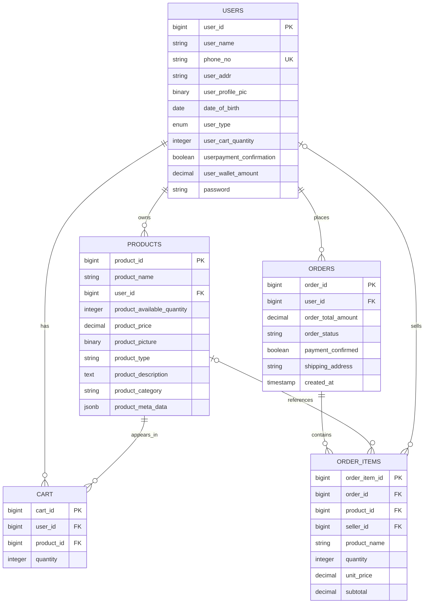

# Database Documentation

## 1. Database Platform

The application documentation specifies PostgreSQL. This is consistent with source code that uses PostgreSQL `ILIKE`, JSONB metadata, and PostgreSQL-specific constraint alterations. Although `.env.example` defaults to SQLite, that default should not be treated as a supported configuration for the full application.

## 2. Entity-Relationship Diagram

The `o|` relationship notation indicates that an order item can have a nullable product or seller reference; the order item still retains a product-name snapshot and purchase prices.

## 3. Tables

### `users`

| Column | Meaning / constraints |
|---|---|
| `user_id` | Auto-incrementing primary key |
| `user_name` | Name, nullable, maximum 100 characters |
| `phone_no` | Unique phone-number login identifier, maximum 150 characters |
| `user_addr` | Optional address; checkout updates this value to the submitted shipping address |
| `user_profile_pic` | Optional binary profile image |
| `date_of_birth` | Optional date |
| `user_type` | Role: `admin`, `seller`, or `buyer`; defaults to `buyer` |
| `user_cart_quantity` | Stored aggregate quantity of the user's cart |
| `userpayment_confirmation` | Boolean flag; column was renamed from a misspelled legacy name by a later migration |
| `user_wallet_amount` | Decimal wallet balance, precision 12, scale 2; defaults to zero |
| `password` | Hashed password stored as a string |
| `remember_token` | Laravel remember-me token field |

The model hides `password` and `remember_token` from serialized output and casts the wallet to a two-decimal representation.

### `products`

| Column | Meaning / constraints |
|---|---|
| `product_id` | Auto-incrementing primary key |
| `product_name` | Required name, maximum 200 characters |
| `user_id` | Seller owner; foreign key to `users.user_id`, cascades on user deletion |
| `product_available_quantity` | Integer stock quantity; defaults to zero |
| `product_price` | Decimal price, precision 12, scale 2 |
| `product_picture` | Optional binary image data |
| `product_type` | Optional enum/check-constrained product type |
| `product_description` | Optional description text |
| `product_category` | Category enum/check constraint |
| `product_meta_data` | Optional PostgreSQL JSONB metadata |

The model defines supported categories and product types as constants. A migration adds `Others` to the product type check constraint.

### `cart`

| Column | Meaning / constraints |
|---|---|
| `cart_id` | Auto-incrementing primary key |
| `user_id` | Owner; foreign key to `users`, cascades on user deletion |
| `product_id` | Product; foreign key to `products`, cascades on product deletion |
| `quantity` | Integer quantity, defaults to one |

A unique constraint on (`user_id`, `product_id`) prevents duplicate cart lines for the same buyer/product pair. The table has no timestamps.

### `orders`

| Column | Meaning / constraints |
|---|---|
| `order_id` | Auto-incrementing primary key |
| `user_id` | Buyer; foreign key to `users`, cascades on user deletion |
| `order_total_amount` | Total amount, decimal(12,2) |
| `order_status` | String status, defaults to `pending`; checkout creates `paid` orders |
| `payment_confirmed` | Boolean, defaults to false; checkout sets true |
| `shipping_address` | Optional shipping address |
| `created_at` | Timestamp defaulting to current time |

The Eloquent model disables automatic timestamps because this table has only `created_at`, not `updated_at`.

### `order_items`

| Column | Meaning / constraints |
|---|---|
| `order_item_id` | Auto-incrementing primary key |
| `order_id` | Parent order; cascades when order is deleted |
| `product_id` | Nullable product reference; set null when the product is deleted |
| `seller_id` | Nullable seller/user reference; set null when the user is deleted |
| `product_name` | Snapshot of product name at purchase time |
| `quantity` | Purchased quantity |
| `unit_price` | Price per unit at purchase time |
| `subtotal` | Quantity multiplied by unit price |

The snapshot fields help preserve invoice information when the original product is later unavailable.

### Framework support tables

The migrations also create Laravel cache, jobs, and sessions tables. These are framework infrastructure rather than marketplace business entities.

## 4. Relationships

- One user can own many products (`User::products`, `Product::seller`).
- One user can have many cart lines; each cart line belongs to one user and one product.
- One user can place many orders; each order belongs to one buyer.
- One order has many order items.
- Each order item can refer to a product and seller, while preserving product name and prices as snapshots.

## 5. Integrity and Transaction Behavior

- `users.phone_no` is unique.
- `cart(user_id, product_id)` is unique.
- Foreign keys implement cascade or set-null behavior depending on the relationship.
- Checkout uses `DB::transaction` and row-level locks for buyer, products, and seller rows before updating wallet balances and stock.
- Cart and order records use explicit custom primary keys, which the models declare.

## 6. Schema and Configuration Considerations

1. Use PostgreSQL for development and tests.
2. Keep test and development databases separate; never point tests at production data.
3. Review the migration that renames `userpayment_confirmantion` to `userpayment_confirmation` when upgrading an existing database. The initial migration and later migration must run in order.
4. The product type and category lists are encoded in migrations and model constants. Keep them synchronized when adding values.
5. The `user_cart_quantity` field duplicates data derivable from `cart`; the application updates it after cart changes. Consider deriving it at query time or testing reconciliation to avoid drift.
6. Binary image columns work for the current implementation but should be evaluated against object/file storage as scale increases.
