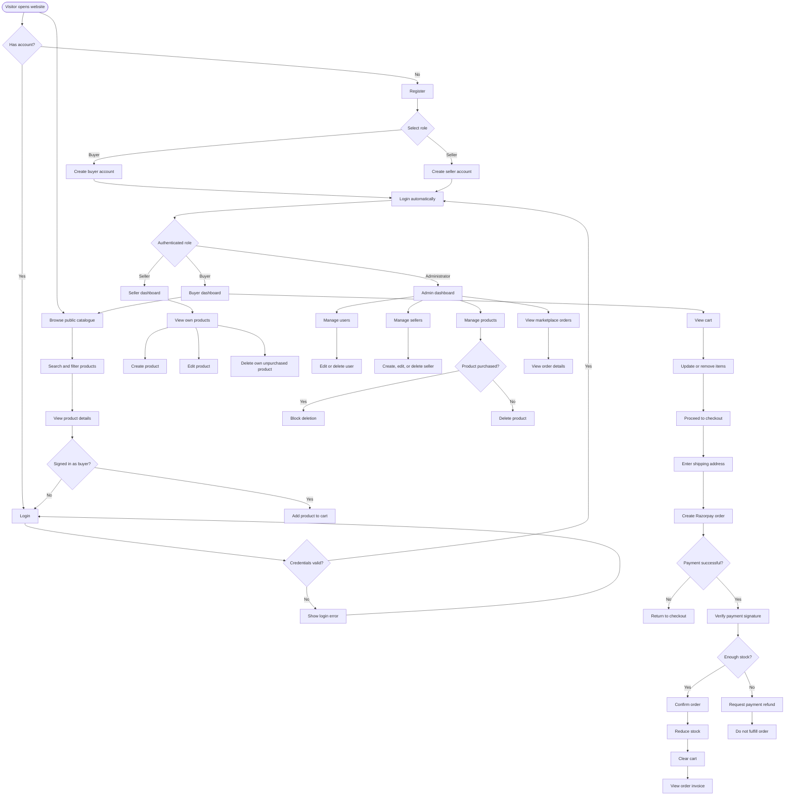
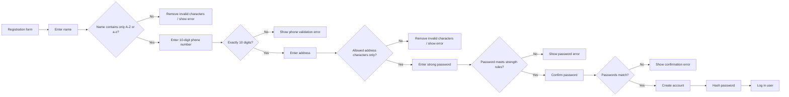
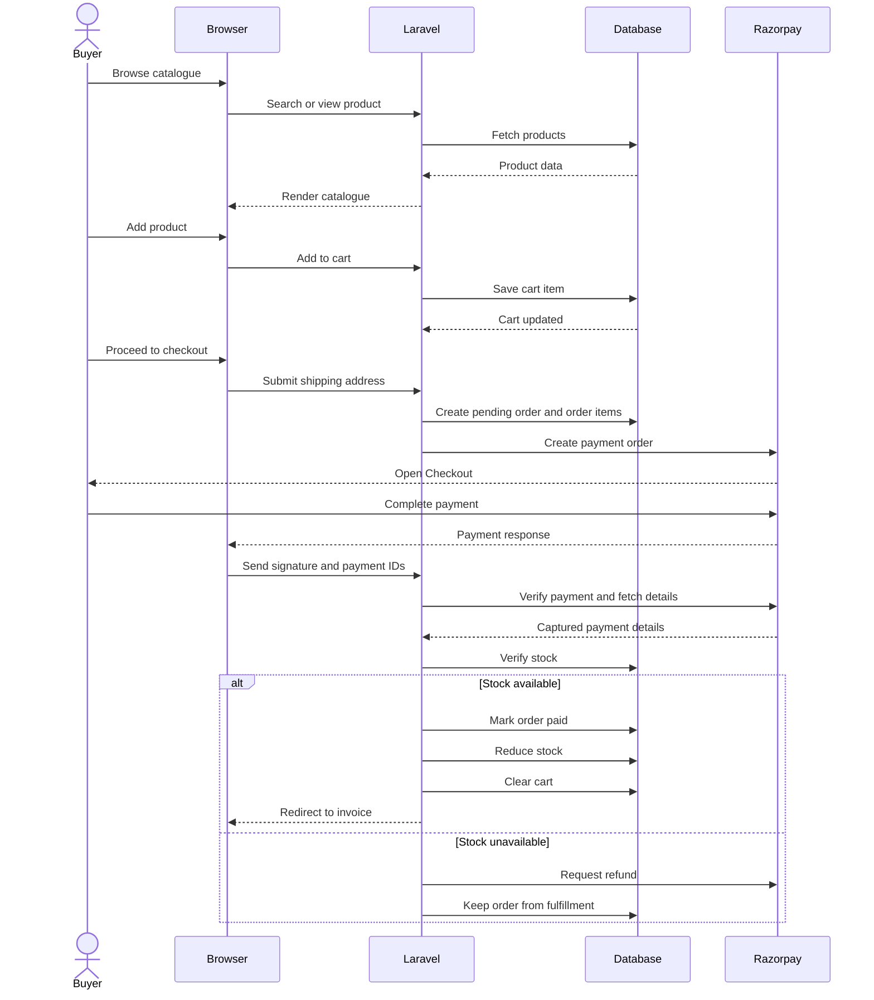
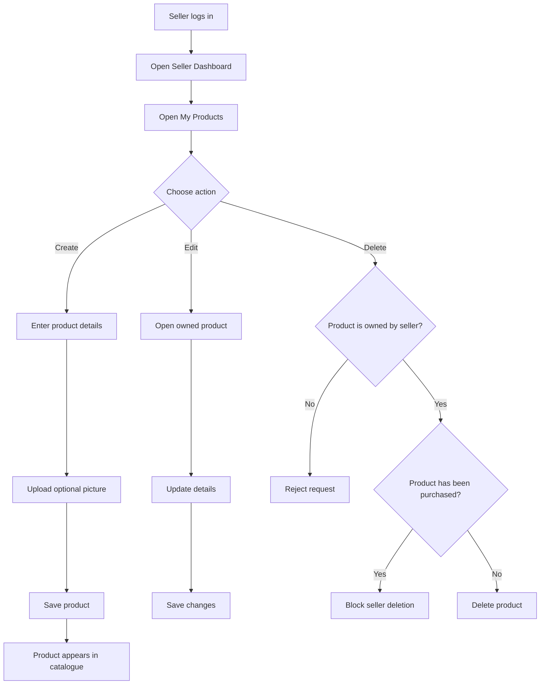
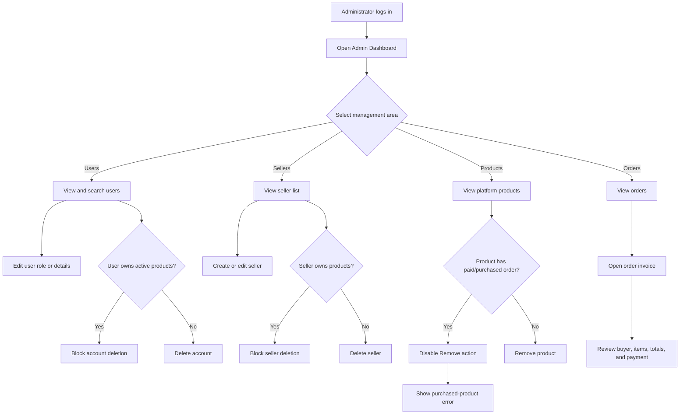
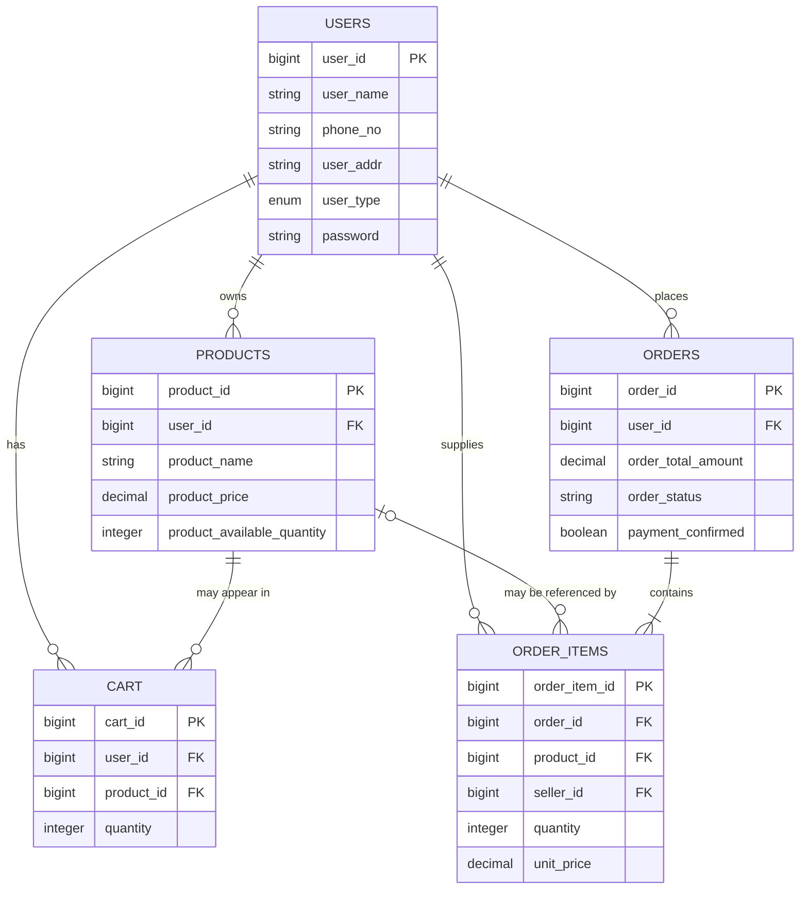

# Online Shopping Cart

A Laravel-based multi-seller marketplace where visitors can browse products, buyers can manage a cart and pay for orders through Razorpay, sellers can manage their own listings, and administrators can oversee marketplace activity.

## Table of Contents

- [Project Overview](#project-overview)
- [Features](#features)
- [Technology Stack](#technology-stack)
- [Architecture](#architecture)
- [Application Logic Guide](#application-logic-guide)
- [Website Flowcharts](#website-flowcharts)
- [Roles and Access](#roles-and-access)
- [Razorpay Payments](#razorpay-payments)
- [Database Overview](#database-overview)
- [Project Structure](#project-structure)
- [Requirements](#requirements)
- [Setup in WSL](#setup-in-wsl)
- [Running the Application](#running-the-application)
- [Demo Data](#demo-data)
- [Tests](#tests)
- [Important Notes](#important-notes)

## Project Overview

The application follows Laravel's server-rendered Model–View–Controller (MVC) pattern. Routes map HTTP requests to controllers. Controllers validate input and implement workflows. Eloquent models represent database entities and relationships, and Blade templates render the pages returned to the browser.

The project is intended as a marketplace demonstration and does not provide shipping integrations or seller payouts.

## Features

### Public product catalogue

- Browse products and view product details without signing in.
- Search by product name or description.
- Filter by category, product type, price range, or stock availability.
- Sort by newest, price, or name, and navigate paginated results.
- View product images and seller information.

### Accounts and authorization

- Register as a buyer or seller and sign in using a unique phone number and password.
- Store passwords as Laravel hashes.
- Use authentication and role middleware to protect restricted routes.
- Serve an authenticated user's profile picture when one is available.

### Seller tools

- Create, list, update, and delete seller-owned product listings.
- Manage price, inventory, category, type, description, metadata, and optional pictures.
- Scope listing changes to the signed-in seller.

### Buyer shopping and orders

- Add products to a buyer-specific cart, change quantities, remove items, or clear the cart.
- Validate stock and prevent sellers from purchasing their own products.
- Review the order total and submit a shipping address at checkout.
- Pay through Razorpay Checkout using supported card and UPI methods, including UPI QR where available.
- View order history and itemized invoices.

### Administration

- Review dashboard metrics for users, sellers, buyers, products, stock, orders, and paid-order revenue.
- Manage users, sellers, products, and platform orders.
- Apply admin-only access checks to administrative routes.

## Technology Stack

| Area | Technology |
|---|---|
| Backend | PHP 8.3+ and Laravel 13 |
| Database | PostgreSQL |
| Data access | Laravel Eloquent ORM |
| Templates | Blade |
| Frontend assets | CSS, Vite, and Tailwind CSS |
| Tests | Pest and PHPUnit |
| Dependency managers | Composer and npm |

PostgreSQL is required for the complete application. Catalogue searches use PostgreSQL `ILIKE`, and the schema includes PostgreSQL-specific features such as JSONB and database constraints. SQLite is not a drop-in replacement.

## Architecture

```text
Browser
  -> routes/web.php
  -> authentication and role middleware
  -> controller
  -> Eloquent models
  -> PostgreSQL
  -> Blade view
  -> Browser
```

Checkout creates a pending local order and Razorpay payment order. The server verifies Razorpay's signature and confirms the captured amount before decrementing stock and clearing the buyer's cart. If stock runs out after payment, the application requests a refund instead of fulfilling the order.

Razorpay credentials are required for checkout. Use test-mode credentials during development. Payment methods shown in Checkout depend on the methods enabled for the Razorpay account.

## Razorpay Payments

The application uses Razorpay Standard Checkout. Customers can pay by card or UPI when those payment methods are enabled for the merchant account. UPI QR availability depends on Razorpay account settings and the checkout flow.

### Configure credentials

1. Generate API keys in the Razorpay Dashboard's **Test Mode**.
2. Set the keys in the project-root `.env` file:

   ```dotenv
   RAZORPAY_KEY_ID=rzp_test_your_key_id
   RAZORPAY_KEY_SECRET=your_razorpay_test_key_secret
   ```

3. If Laravel configuration is cached, run `php artisan config:clear`, then restart the development server.
4. Confirm UPI is enabled in the Razorpay Dashboard if it is not shown in Checkout.

Keep the secret key private and out of source control. For production, complete Razorpay account activation and configure Live Mode keys in the production environment.

### Payment flow

The server creates a pending local order and a matching Razorpay order in INR. Razorpay Checkout collects the payment details; the server then verifies the checkout signature and fetches the payment from Razorpay to confirm its order, amount, currency, and captured status. Only a verified captured payment fulfills the order, reduces stock, and clears the matching cart items. If stock is no longer available after payment, the application requests a refund instead of fulfilling the order.

### Testing and troubleshooting

Use Test Mode keys and Razorpay's test payment details to complete a checkout without charging a real payment method. Creating an API test order verifies the credentials and connectivity, but does not test the browser checkout or a completed payment.

The application does not currently use payment webhooks. If a customer closes the browser before the checkout response is verified, an order can remain pending and may need manual reconciliation. If PHP reports `cURL error 60`, configure a trusted CA bundle for the active PHP installation; do not disable TLS certificate verification.

## Roles and Access

| Role | Main capabilities |
|---|---|
| Visitor | Browse, search, and view products |
| Buyer | Manage own cart, check out, and view own orders |
| Seller | Manage own products; may also browse the public catalogue |
| Administrator | Manage platform users, sellers, products, and orders |

Registration allows buyer and seller roles; it does not provide public admin registration. Role middleware is defined under `app/Http/Middleware/`, aliased in `bootstrap/app.php`, and applied to route groups in `routes/web.php`. Cart and order queries are scoped to the signed-in buyer; seller product updates and deletions are scoped to the listing owner.

## Database Overview

| Table | Purpose |
|---|---|
| `users` | User identity, role, profile, and cart quantity |
| `products` | Seller-owned product details, price, inventory, and metadata |
| `cart` | Buyer/product cart lines and quantities |
| `orders` | Buyer, order total, shipping address, payment status, and Razorpay references |
| `order_items` | Product-name and price snapshots for each purchased item |

The primary business relationships are:

- A user can own many products, cart lines, and orders.
- Each cart line belongs to a user and a product.
- An order belongs to a buyer and contains order items.
- An order item can refer to its original product and seller while retaining purchase-time details.

Migrations also create Laravel support tables for sessions, cache, and queued jobs. Database structure is maintained in `database/migrations/`; Eloquent relationships are in `app/Models/`.

## Project Structure

```text
app/
  Http/Controllers/   Request handling and application workflows
  Http/Middleware/    Role-based access checks
  Models/             Eloquent models and relationships
bootstrap/            Laravel application and middleware configuration
database/
  factories/          Test and demo model factories
  migrations/         Database schema
  seeders/            Demo data
resources/views/      Blade templates for each application area
resources/css/        Frontend stylesheet sources
resources/js/         Frontend JavaScript entry point
routes/
  web.php             Browser routes
  console.php         Console routes
tests/
  Feature/            HTTP and business workflow tests
  Unit/               Unit tests
```

The principal controllers are `AuthController`, `ProductController`, `CustomerController`, `CartController`, `OrderController`, `SellerController`, and `AdminController`.

## Requirements

- PHP 8.3 or newer with PostgreSQL PDO support (`pdo_pgsql`) and the extensions required by Laravel and image handling.
- Composer.
- PostgreSQL server and a database/user for this application.
- Node.js and npm.

For PHP-based testing, enable the XML/DOM extension required by PHPUnit. Check the CLI PHP installation with:

```bash
php -v
php -m
```

## Setup in WSL

Run these commands from the WSL project directory:

```bash
cd /home/dbbcs/Online-Shopping-Cart
composer install
npm ci
```

Create a local `.env` from `.env.example` if one does not already exist. Configure it for PostgreSQL, for example:

```dotenv
APP_NAME="Online Shopping Cart"
APP_ENV=local
APP_DEBUG=true
APP_URL=http://localhost:8000

DB_CONNECTION=pgsql
DB_HOST=127.0.0.1
DB_PORT=5432
DB_DATABASE=online_shopping_cart
DB_USERNAME=your_local_database_user
DB_PASSWORD=your_local_database_password

RAZORPAY_KEY_ID=rzp_test_your_key_id
RAZORPAY_KEY_SECRET=your_razorpay_test_key_secret
```

Use your own local database credentials and Razorpay test keys from your Razorpay Dashboard. Do not commit or share `.env`, and do not use production credentials for development or tests. Generate the application key and prepare the database:

```bash
php artisan key:generate
php artisan migrate
```

The PostgreSQL service and configured database must be available before running migrations.

## Running the Application

Start the Laravel development server in WSL:

```bash
php artisan serve
```

Open the address printed by Artisan, usually `http://localhost:8000`. WSL localhost forwarding normally makes the server accessible from a Windows browser.

The storefront includes a public stylesheet at `public/css/market.css`. For frontend source development, run Vite in another terminal:

```bash
npm run dev
```

To create a frontend build:

```bash
npm run build
```

## Demo Data

Optionally create sample users and products:

```bash
php artisan db:seed
```

The seeders create 5 admins, 15 sellers, 30 buyers, and 50 products. Seeded users share the factory password `password`; generated phone numbers and product values vary. Use these accounts only in local development.

Seeding is additive: running it again adds more records. Configure Razorpay test credentials and use a product with enough stock before trying checkout.

## Tests

Configure a dedicated PostgreSQL test database before running the suite. The PHPUnit configuration selects PostgreSQL. Never point tests at a production or valuable database.

Run the suite with:

```bash
php artisan test --compact
```

Feature tests cover authentication, catalogue browsing, carts, checkout, seller tools, administration, and database seeding. To run one test file:

```bash
php artisan test --compact tests/Feature/OrderTest.php
```

Useful application checks:

```bash
php artisan route:list
php artisan migrate:status
```

## Important Notes

- **Secrets:** Keep `.env` and all credentials private. Remove secrets from any archive or public repository and rotate them if they have been exposed.
- **Database reset:** `php artisan migrate:fresh --seed` drops all tables in the configured database. Use it only with a disposable local database after verifying the active connection.
- **Payments:** Checkout requires Razorpay test/live credentials. Card and UPI options are offered by Razorpay Checkout according to account settings; no seller payout integration is included.
- **Seeder behavior:** Seeders add records and are not idempotent by default.
- **Production readiness:** Before deployment, configure secure production environment settings, review concurrency error handling, validate all incoming values, and run tests against a properly configured PostgreSQL environment.

## Application Logic Guide

This section maps the website's main behavior to the source files where its logic is implemented.

### Request flow

```text
Browser request
  -> routes/web.php
  -> authentication / role middleware
  -> app/Http/Controllers/
  -> app/Models/ and database/
  -> resources/views/
  -> Browser response
```

### Main logic locations

| Feature | Entry point | Logic |
|---|---|---|
| Routes and access control | `routes/web.php` | Maps URLs to controllers and groups routes by authentication, buyer, seller, and admin roles. |
| Login and registration | `app/Http/Controllers/AuthController.php` | Validates new accounts, hashes passwords, authenticates users, and logs users out. |
| Profile editing | `app/Http/Controllers/CustomerController.php` | Shows and updates the signed-in user's name, phone, address, birth date, password, and profile picture. |
| Product catalogue | `app/Http/Controllers/ProductController.php` | Searches, filters, sorts, and displays products and product pictures. |
| Cart | `app/Http/Controllers/CartController.php` | Adds, updates, removes, or clears the current buyer's cart; checks stock and prevents sellers from buying their own products. |
| Checkout and payment | `app/Http/Controllers/OrderController.php` | Creates pending orders, starts Razorpay checkout, verifies payment, checks stock, fulfills orders, and requests refunds when stock is unavailable. |
| Seller operations | `app/Http/Controllers/SellerController.php` | Manages sellers and limits seller product changes to products they own. |
| Administrator operations | `app/Http/Controllers/AdminController.php` | Manages users, sellers, products, and orders; blocks deletion of purchased products. |
| Role checks | `app/Http/Middleware/` | Restricts buyer-, seller-, and admin-only routes. Middleware aliases are configured in `bootstrap/app.php`. |

### Accounts and profiles

1. Registration and login are routed through `AuthController`.
2. Registration permits buyer and seller roles; admin accounts are not created through public registration.
3. Signed-in users can edit their profile through the profile routes.
4. Server validation restricts names to letters, phone numbers to exactly 10 digits, and addresses to letters, digits, spaces, commas, hyphens, and parentheses.
5. Passwords are hashed before saving. Profile pictures are validated and served through an authenticated route.

Related files:

- Routes: `routes/web.php`
- Profile page: `resources/views/profile/edit.blade.php`
- Dashboard link: `resources/views/dashboard.blade.php`
- Live input filters: `public/js/name-validation.js` and `public/js/address-validation.js`

### Shopping and payment logic

1. Public catalogue requests are handled by `ProductController`.
2. A buyer's cart is scoped to the signed-in user in `CartController`.
3. Checkout validates the shipping address, locks cart and product rows, verifies stock, and creates a pending order with purchase-time item snapshots.
4. The server creates a Razorpay order. After checkout, it verifies the signature and payment status before marking an order as paid.
5. Successful fulfillment reduces stock and clears matching cart quantities. If stock is no longer available, the order is marked for refund instead of fulfillment.

Related files:

- Cart: `resources/views/cart/index.blade.php`
- Checkout: `resources/views/orders/checkout.blade.php`
- Order history and details: `resources/views/orders/index.blade.php` and `resources/views/orders/show.blade.php`
- Payment configuration: `config/services.php`

### Product management logic

- Sellers create and edit product details in `SellerController`; product metadata is stored as JSON and displayed as specification tags.
- Admin product deletion checks paid/purchased order items and refuses deletion if a purchase exists.
- Product and order relationships are defined in `app/Models/Product.php`, `app/Models/Order.php`, and `app/Models/OrderItem.php`.
- Product specifications are rendered in `resources/views/products/show.blade.php`.

### Data and seed logic

| Data | Source |
|---|---|
| Database schema | `database/migrations/` |
| User model and role helpers | `app/Models/User.php` |
| Product model and categories/types | `app/Models/Product.php` |
| Generated user data | `database/factories/UserFactory.php` |
| Generated product data, including Indian brand metadata | `database/factories/ProductFactory.php` |
| User seed counts | `database/seeders/UserSeeder.php` |
| Product seed count | `database/seeders/ProductSeeder.php` |
| Seeder order | `database/seeders/DatabaseSeeder.php` |

Run all seeders with `php artisan db:seed`, or just product seeds with `php artisan db:seed --class=ProductSeeder`. Seeding is additive.

### Tests

Feature tests for authentication, profile updates, products, cart, checkout, seller tools, and admin actions live in `tests/Feature/`.

```powershell
php artisan test
```

## Website Flowcharts

The following Mermaid diagrams visualize the visitor, buyer, seller, administrator, account validation, payment, and database flows. Markdown viewers with Mermaid support will render them as diagrams.

### Overall website flow



### Account validation flow



### Buyer payment flow



### Seller product management flow



### Administrator management flow



### Database relationship flow


