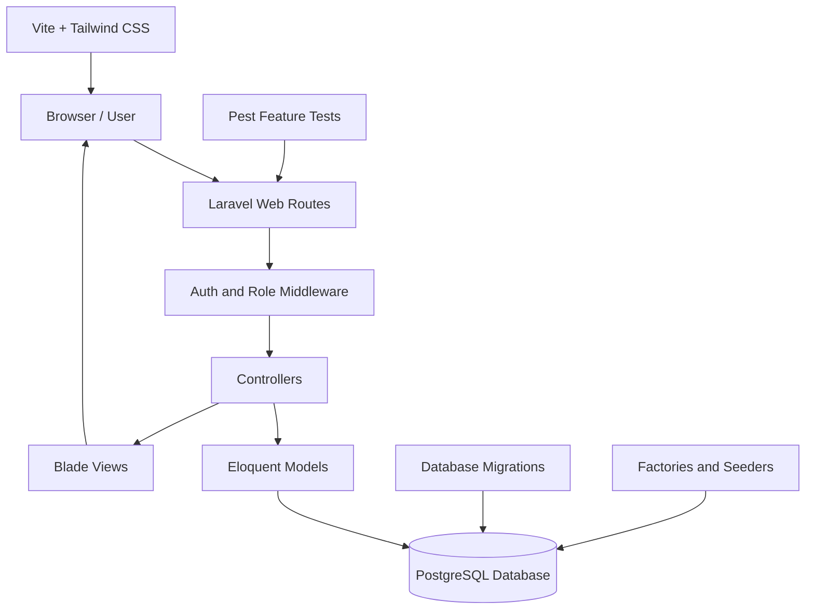
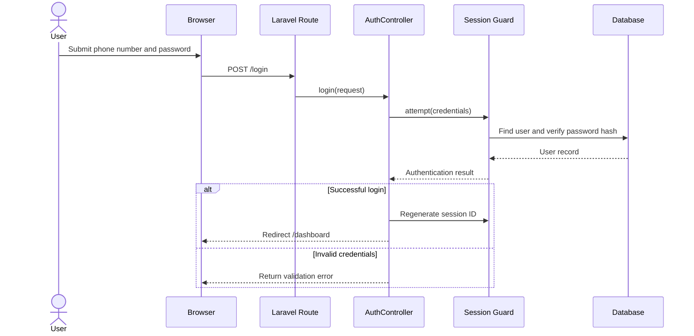
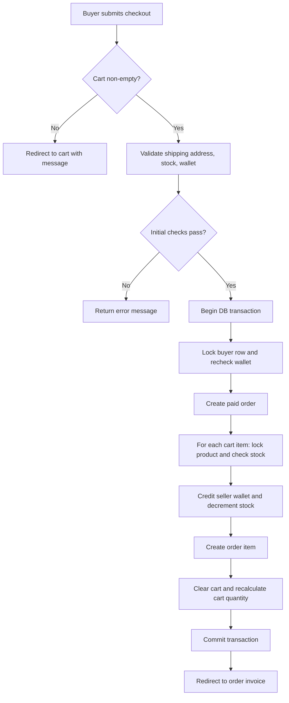

# System Architecture

## 1. Architectural Style

The application follows Laravel's server-rendered Model–View–Controller (MVC) structure:

- **Routes** (`routes/web.php`) map URLs and HTTP methods to controller actions.
- **Middleware** checks authentication and role permissions before protected actions run.
- **Controllers** implement request validation and business workflows.
- **Eloquent models** represent users, products, cart lines, orders, and order items.
- **Blade views** in `resources/views` render HTML pages.
- **Migrations** define database tables and constraints; factories and seeders provide test/demo data.
- **Vite and Tailwind CSS** build frontend assets from `resources/js` and `resources/css`.

## 2. High-Level Component Diagram



## 3. Application Layers

### Presentation layer

The `resources/views` directory contains pages for authentication, products, cart, checkout, order history/invoices, seller management, and administration. `resources/js/app.js` and `resources/css/app.css` are the frontend entry points.

### Routing and access-control layer

`routes/web.php` defines public routes and authenticated route groups. `bootstrap/app.php` registers the aliases:

- `admin` → `AdminMiddleware`
- `seller` → `SellerMiddleware`
- `buyer` → `BuyerMiddleware`

`auth` is Laravel's authentication middleware. Administrator routes require `auth` and `admin`; seller product routes require `auth` and `seller`; buyer cart routes require `auth` and `buyer`. Buyer checkout and order routes are within the buyer route group.

### Business-logic layer

| Controller | Responsibility |
|---|---|
| `AuthController` | Registration, login, logout |
| `ProductController` | Public catalogue, product detail, image response |
| `CustomerController` | Authenticated dashboard routing |
| `CartController` | Cart read/write, quantity validation, totals |
| `OrderController` | Checkout, wallet payment, order creation, history, invoice |
| `SellerController` | Admin seller management and seller-owned product management |
| `AdminController` | Admin metrics, user/product/order administration |

### Persistence layer

Eloquent models define custom primary keys (`user_id`, `product_id`, `cart_id`, `order_id`, and `order_item_id`) and explicit relationships. Database migrations add foreign keys, a unique cart user/product pair, JSONB product metadata, binary image columns, and PostgreSQL-specific constraints.

## 4. Authentication and Request Flow



After login, `/dashboard` is handled by `CustomerController`. Administrators are redirected to `admin.dashboard`; other authenticated users see `dashboard`. Seller-specific pages are available through the seller route group. Registration accepts `buyer` or `seller`, not `admin`.

## 5. Checkout Transaction



The transaction groups wallet, stock, order, and cart mutations so that a database exception should roll back the operation. The source currently throws `RuntimeException` if a balance or stock race is detected after locking; controlled handling of that exception should be added and tested.

## 6. Directory Structure

```text
online_shopping_cart/
├── app/
│   ├── Http/Controllers/       # Request handlers and business workflows
│   ├── Http/Middleware/        # Admin, buyer, seller access checks
│   ├── Models/                 # Eloquent models and relationships
│   └── Providers/
├── bootstrap/app.php           # Framework setup and middleware aliases
├── config/                     # Laravel configuration
├── database/
│   ├── factories/              # Test/demo model factories
│   ├── migrations/             # Database schema changes
│   └── seeders/                # Demo account and product seeders
├── public/                     # Public entry point and built assets
├── resources/
│   ├── css/                    # Tailwind CSS entry point
│   ├── js/                     # JavaScript entry point
│   └── views/                  # Blade templates
├── routes/web.php              # Web routes
├── routes/console.php          # Artisan commands
├── tests/Feature/              # HTTP/business-flow tests
├── tests/Unit/                 # Unit tests
├── composer.json               # PHP dependencies and scripts
├── package.json                # Frontend dependencies and scripts
└── vite.config.js              # Frontend build configuration
```

The archive also contains development-agent configuration folders (`.agents` and `.claude`), installed `vendor` and `node_modules` directories, and a real `.env` file. Dependency folders should normally be recreated from lock files rather than included in a source archive. Do not redistribute the `.env` file.

## 7. Architectural Strengths

- Role checks are centralized in middleware and applied to route groups.
- Product ownership is checked when sellers edit or delete listings.
- Cart and order queries are scoped to the authenticated buyer.
- Checkout groups financial and inventory changes in a database transaction.
- Migrations, factories, seeders, and feature tests support repeatable development.

## 8. Architectural Risks

- PostgreSQL is assumed by `ILIKE`, JSONB, binary image handling, and schema alteration migrations; SQLite is not a drop-in replacement.
- The example environment defaults to SQLite despite the project installation guide requiring PostgreSQL.
- A checked-out archive includes `.env`; this creates a risk of disclosing application keys or credentials.
- Checkout concurrency exceptions need controlled user-facing handling.
- Image bytes are stored in database columns, which may become costly at scale.
