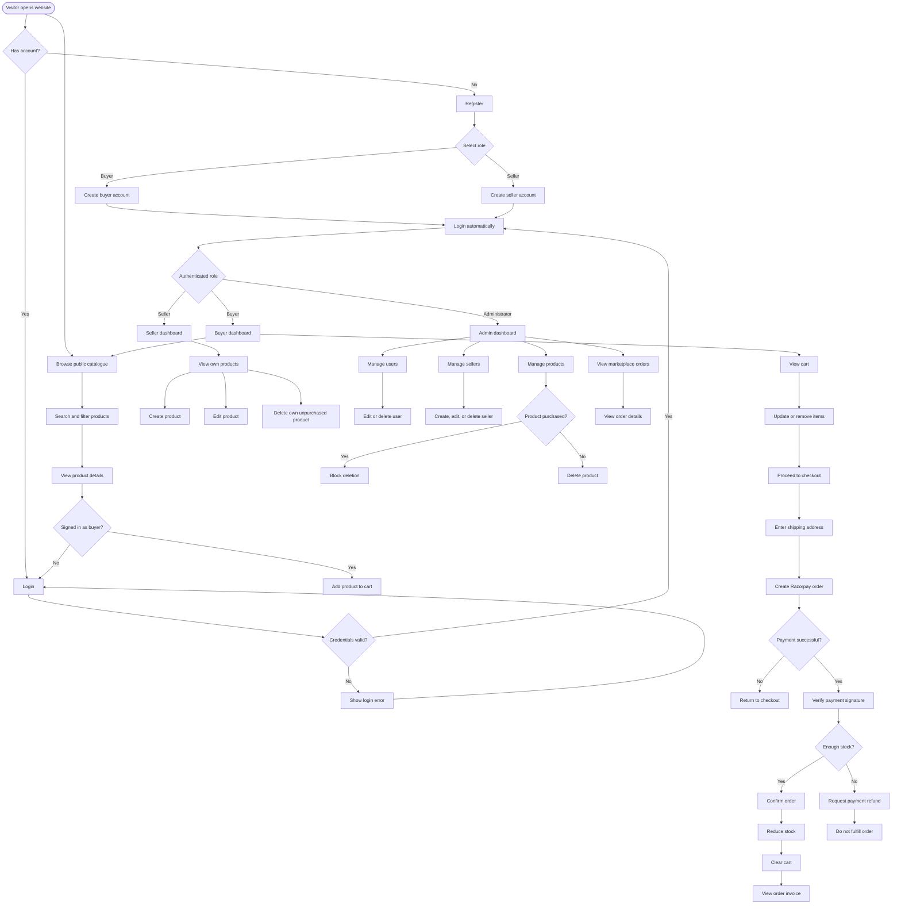
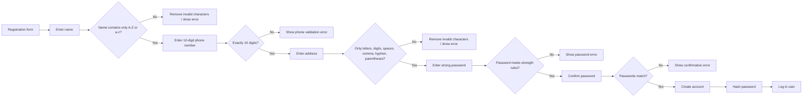
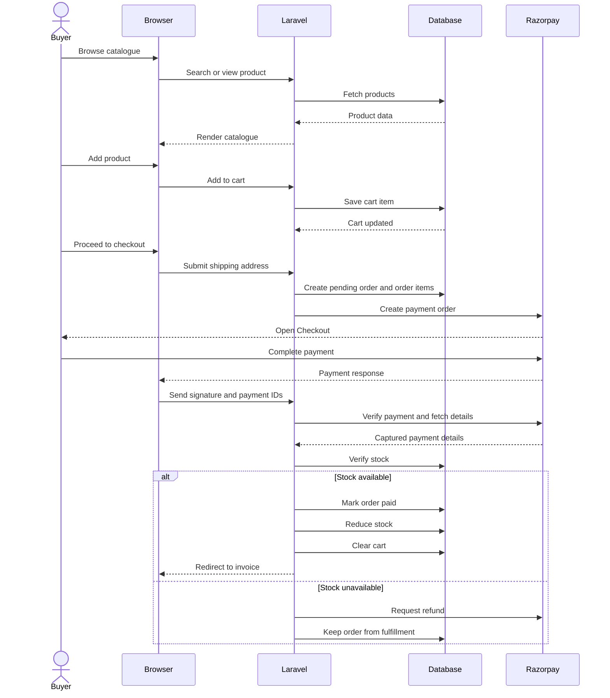
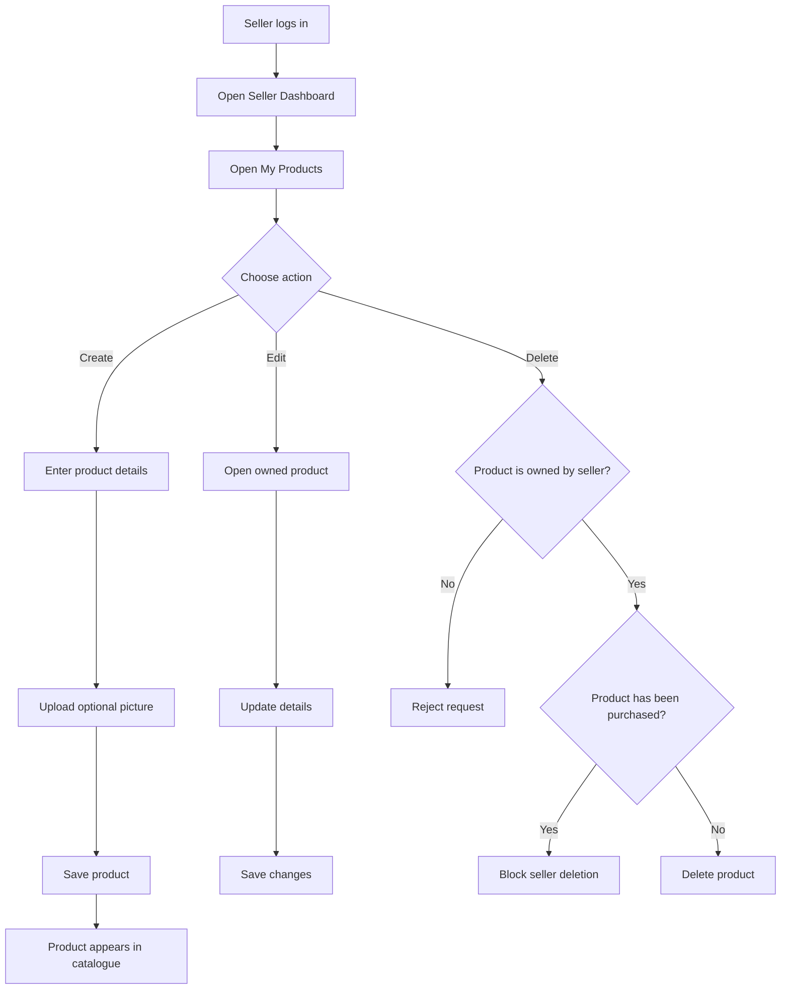
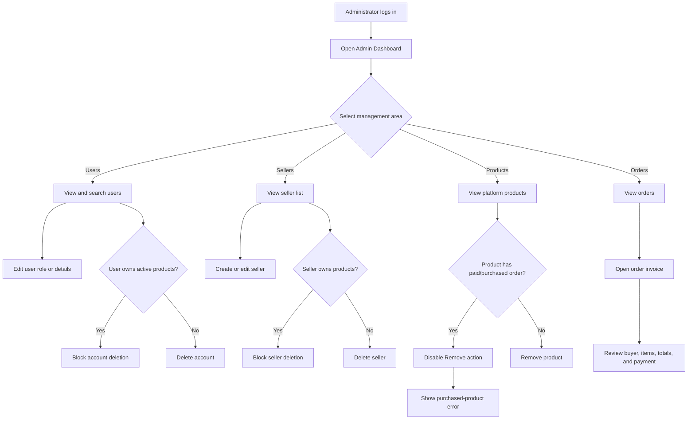
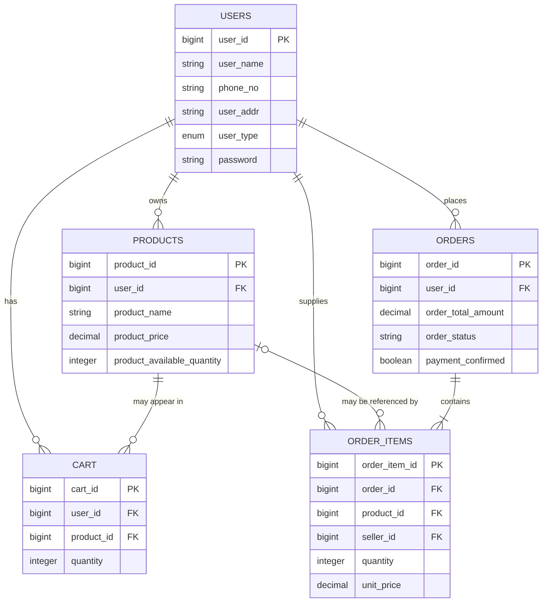

# Online Shopping Cart - Website Flowchart

This document visualizes the main visitor, buyer, seller, administrator, and payment flows.

## Overall Website Flow

## Authentication and Validation Flow

## Buyer Purchase Flow

## Seller Product Management Flow

## Administrator Management Flow

## Database Relationship Flow

